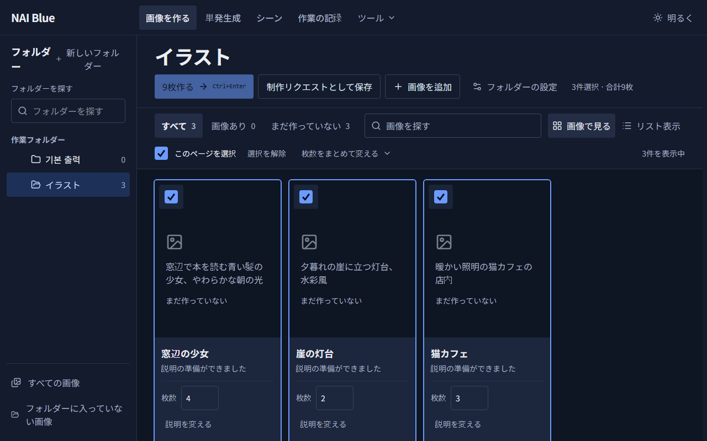
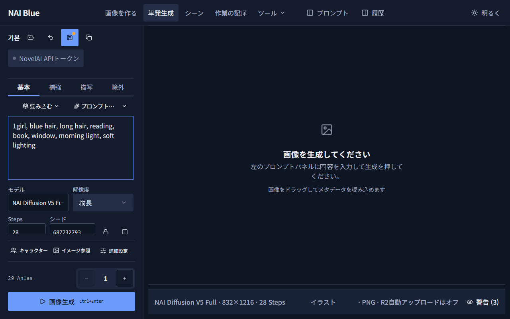
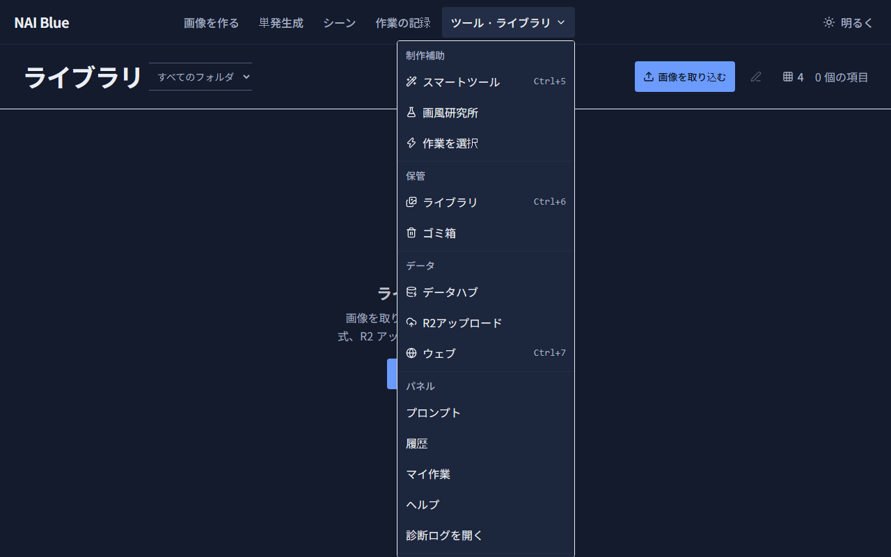

# NAI Blue

<p align="center">
  
</p>

<p align="center">
  NovelAI の画像を計画し、生成し、整理するためのデスクトップ・Android ワークスペース
</p>

<p align="center">
  <a href="./README.md">English</a> ·
  <a href="./README.ko.md">한국어</a> ·
  <a href="./README.ja.md">日本語</a>
</p>

> NAI Blue は独立したコミュニティクライアントであり、NovelAI と提携した製品でも公式に承認された製品でもありません。



## できること

| 画面 | 用途 |
|---|---|
| **画像を作る** | フォルダーに画像の説明を集め、説明ごとに枚数を決め、数量と保存先を確認してからまとめて生成します。まとまりは制作リクエストとして保存し、あとでもう一度実行できます。 |
| **単発生成** | 1 つのプロンプトを 4 つの欄(基本、補強、描写、除外)に分けて書き、キャラクターとイメージ参照を加え、モデルと解像度を選んで 1 枚ずつ生成します。 |
| **シーン** | プロンプトをカードとして保存し、複数のシーンを一度に生成します。 |
| **作業の記録** | 進行状況を追い、完成した画像を確認し、確認が必要な作業を処理します。 |
| **ツール** | スマートツール(背景除去、モザイク、アップスケール)、画風研究所(好みに合わせて育てるアーティストタグの組み合わせ)、ライブラリ、ゴミ箱、データハブ、R2アップロード、タグ検索ブラウザ、設定。 |

どの画面でも `Ctrl/Cmd+K` で**コマンド検索**を開き、`Ctrl/Cmd+Enter` で今の画面の主な操作を実行します。





## インストール

[GitHub Releases](https://github.com/bluehair-blue/NAI-Blue/releases/latest) から、お使いの OS に合ったインストーラーを取得してください。

- Windows: `x64-setup.exe` を使用します。管理環境向けに MSI も提供しています。
- macOS: Apple Silicon は `aarch64`、Intel Mac は `x64` ビルドを使用します。破損しているという警告が出た場合は、このリポジトリから取得したファイルであることを確認してから、ターミナルで `xattr -cr "/Applications/NAI Blue.app"` を実行してください。
- Android: 署名済みの universal APK をインストールします。APK を開いたアプリに「不明なアプリのインストール」を許可する必要がある場合があります。

## はじめに

**ツール → ヘルプ**を開くと、アプリ内のスタートガイドが次の手順のうち残っているものを示します。

1. Credential Vault を開き(ガイドまたは**設定 → API**)、ロックを解除して検証済みの NovelAI トークンを保存します。トークンは OS の保管庫で暗号化されます。
2. 画像の保存先と形式、メタデータの扱いを選びます: **メタデータを埋め込む**、**サイドカーのみ**、**画像メタデータを削除しサイドカーを作成**。
3. **画像を作る**で画像ごとに説明を 1 つ書き、枚数を決めて**作る画像を追加**を押し、**N枚作る**で開始します。1 枚だけ作るときは**単発生成**の**画像生成**を使います。
4. **作業の記録**で作業を追います。

R2 アップロードは任意です。リモート保存が必要な場合のみ、**ツール → R2アップロード**で設定してください。

## メタデータの読み込み

**単発生成**の画面に画像をドラッグすると、生成設定を読み込みます。**データハブ → 画像情報**では一度に 500 件まで読み込めます。PNG・WebP・JPEG 画像、`.nai-blue.json` サイドカー、対応する外部サイドカー JSON を読み込み、NAIS2・NAIS3 で作成した画像も含まれます。

## フォルダー、デバイス、プライバシー

- フォルダーごとに、保存先、共通の画像説明、R2 アップロードの有無を設定します。
- **データハブ → 接続**でデスクトップとモバイルのアプリを接続します。
- **スマートツール**の背景除去と画風分析は、選択した画像を外部の Hugging Face Spaces に送信します。NovelAI トークンは送信しません。
- Android でデスクトップが必要な機能は、理由と代替手段とともにそのまま表示されます。

## AI エージェント

**データハブ → AI編集**で登録した AI エージェントからのリクエストを受け付けられます。登録されたエージェントは、このリポジトリの MCP アダプター(`scripts/run-agent-mcp-stdio.mjs`)を通じて、プロンプト、生成設定、保存先を読み取り、検証済みの編集を送信し、生成をリクエストします。編集と生成を毎回承認するかどうかは、接続ごとに自分で決めます。

接続方法は [ADR-013](docs/architecture/ADR-013-agent-folder-production.md) に、自動化エージェントが守るルールは[エージェント自動化ガイド](docs/에이전트%20자동화%20안내.md)(韓国語)にあります。

## トラブルシューティングと不具合報告

報告前に次を確認してください。

1. 同じ入力でもう一度試し、失敗した正確な手順を記録します。
2. **ツール → 診断ログを開く**を開きます。
3. 関連するイベントで**編集済みログをコピー**または **JSON をエクスポート**を使います。
4. 最新のリリースノートと既存の [Issue](https://github.com/bluehair-blue/NAI-Blue/issues) を確認します。

[バグレポート](https://github.com/bluehair-blue/NAI-Blue/issues/new?template=bug_report.yml)には次を含めてください。

- NAI Blue のバージョン、OS、インストール方法
- 最短の再現手順
- 期待した結果と実際の結果
- 表示された `DiagnosticCode` と編集済みログ
- トークン、パス、プロンプト、非公開メタデータを隠したスクリーンショット

NovelAI トークン、Cloudflare secret、署名鍵、資格情報バックアップの原本、未確認の非公開サイドカーは添付しないでください。セキュリティ脆弱性は公開 Issue ではなく、リポジトリの非公開 Security Advisory から報告してください。

## ソースからビルド

Node.js 24 LTS、npm、Rust 1.93以降、Tauri に必要なネイティブビルドツールを用意してください。Tagger sidecar を再ビルドする場合は Python 3.11 も必要です。

```bash
git clone https://github.com/bluehair-blue/NAI-Blue.git
cd NAI-Blue
npm ci
npm run tauri dev
```

主な確認コマンド:

```bash
npm run lint
npm run test:composition
npm run build
npm run tauri build
```

デザインの取り決めは [DESIGN.md](./DESIGN.md)、アーキテクチャの決定記録は [docs/README.md](./docs/README.md)、リリース手順は [RELEASING.md](./RELEASING.md) にあります。このページのスクリーンショットは `npm run docs:screenshots` で作り直せます。

## クレジットとライセンス

NAI Blue は [NAIS2](https://github.com/sunanakgo/NAIS2) から出発し、ワイルドカードとシーンのワークフローは [NAIA2.0](https://github.com/DNT-LAB/NAIA2.0) と [SDStudio](https://github.com/sunho/SDStudio) も参考にしました。

[GPL-3.0](./LICENSE) ライセンスで配布します。
