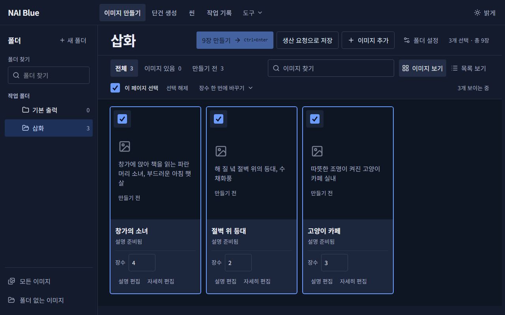
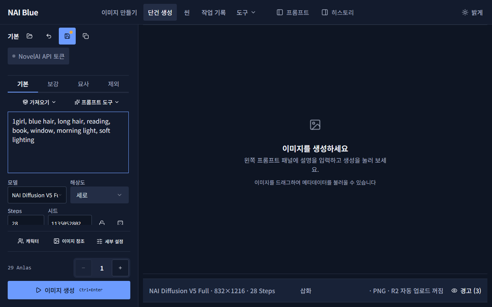
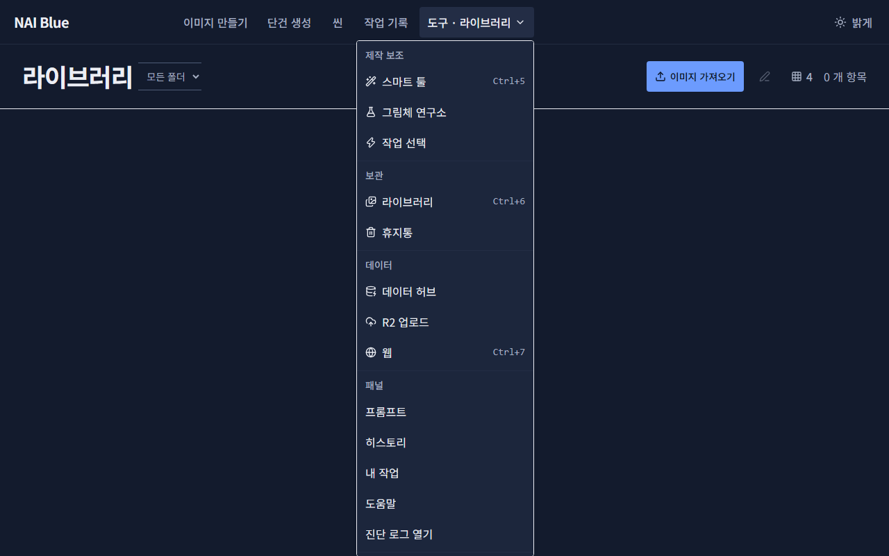

# NAI Blue

<p align="center">
  
</p>

<p align="center">
  NovelAI 이미지를 기획하고, 만들고, 정리하는 데스크톱·Android 작업공간
</p>

<p align="center">
  <a href="./README.md">English</a> ·
  <a href="./README.ko.md">한국어</a> ·
  <a href="./README.ja.md">日本語</a>
</p>

> NAI Blue는 독립 커뮤니티 클라이언트이며 NovelAI와 제휴하거나 공식 승인을 받은 제품이 아닙니다.



## 할 수 있는 일

| 화면 | 용도 |
|---|---|
| **이미지 만들기** | 폴더에 그림 설명을 모으고 설명마다 장수를 정한 뒤, 수량과 저장 위치를 확인하고 한꺼번에 만듭니다. 묶음은 생산 요청으로 저장해 두었다가 다시 돌릴 수 있습니다. |
| **단건 생성** | 프롬프트 하나를 네 칸(기본, 보강, 묘사, 제외)에 나눠 쓰고, 캐릭터와 이미지 참조를 더하고, 모델과 해상도를 골라 한 장씩 만듭니다. |
| **씬** | 프롬프트를 카드로 저장하고 여러 씬을 한 번에 만듭니다. |
| **작업 기록** | 진행 상황을 보고, 끝난 이미지를 확인하고, 확인이 필요한 작업을 처리합니다. |
| **도구** | 스마트 툴(배경 제거, 모자이크, 업스케일, 그림체 분석), 그림체 연구소(취향에 맞춰 가는 작가 태그 조합), 라이브러리, 휴지통, 데이터 허브, R2 업로드, 태그 검색 브라우저, 설정. |

어느 화면에서든 `Ctrl/Cmd+K`로 **명령 찾기**를 열고, `Ctrl/Cmd+Enter`로 지금 화면의 주 동작을 실행합니다.





## 설치

[GitHub Releases](https://github.com/bluehair-blue/NAI-Blue/releases/latest)에서 운영체제에 맞는 설치 파일을 받으세요.

- Windows: `x64-setup.exe`를 사용합니다. 관리형 환경을 위한 MSI도 제공합니다.
- macOS: Apple Silicon은 `aarch64`, Intel Mac은 `x64` 빌드를 사용합니다. Gatekeeper가 손상되었다는 경고를 띄우면 이 저장소에서 받은 파일인지 확인한 뒤 터미널에서 `xattr -cr "/Applications/NAI Blue.app"`을 실행하세요.
- Android: 서명된 universal APK를 설치합니다. APK를 연 앱에 '알 수 없는 앱 설치' 권한을 허용해야 할 수 있습니다.

## 처음 쓰기

본인의 NovelAI 계정이 필요합니다. **도구 → 도움말**을 열면 앱 안의 시작 가이드가 아래 단계 중 무엇이 남았는지 보여 줍니다.

1. Credential Vault를 열어(가이드 또는 **설정 → API**) 잠금을 풀고 NovelAI 토큰을 넣어 검증합니다. 토큰은 운영체제의 보관소로 암호화됩니다.
2. 가이드의 **출력 및 개인정보** 단계에서 이미지 저장 위치와 형식, 메타데이터 처리 방식을 고릅니다: **메타데이터 포함**, **사이드카만 작성**, **이미지 메타데이터 제거 후 사이드카 작성**.
3. **이미지 만들기**에서 이미지마다 설명을 하나씩 쓰고 장수를 정한 뒤 **만들 이미지 추가**를 누르고 **N장 만들기**로 시작합니다. 한 장만 만들 때는 **단건 생성**의 **이미지 생성**을 씁니다.
4. **작업 기록**에서 작업을 따라갑니다.

Cloudflare R2 업로드는 선택 사항입니다. 원격 저장이 필요할 때만 **도구 → R2 업로드**에서 설정하세요.

## 메타데이터 가져오기

**단건 생성** 화면에 이미지를 끌어다 놓으면 생성 설정을 불러옵니다. **데이터 허브 → 이미지 정보**에서는 한 번에 500개까지 읽습니다. PNG·WebP·JPEG 이미지(NAIS2·NAIS3로 만든 이미지 포함), `.nai-blue.json` 사이드카, 지원되는 외부 사이드카 JSON을 읽습니다.

## 폴더, 기기, 개인정보

- 폴더마다 저장 위치, 공통 그림 설명, R2 업로드 여부를 따로 둡니다.
- **데이터 허브 → 기기 연결**에서 데스크톱과 모바일 앱을 연결해 데이터를 옮깁니다.
- **스마트 툴**의 배경 제거와 그림체 분석은 선택한 이미지를 외부 Hugging Face Spaces로 보냅니다. NovelAI 토큰은 보내지 않습니다.
- Android에서 데스크톱 전용 기능은 이유와 대안과 함께 그대로 표시됩니다.

## AI 에이전트

**데이터 허브 → AI 편집**에서 등록한 AI 에이전트의 요청을 받을 수 있습니다. 등록된 에이전트는 이 저장소의 MCP 어댑터(`scripts/run-agent-mcp-stdio.mjs`)로 프롬프트, 생성 설정, 저장 위치를 읽고, 검증된 편집을 제출하고, 생성을 요청합니다. 편집과 생성을 매번 승인할지는 등록한 접속마다 직접 정합니다.

연결 방법은 [ADR-013](docs/architecture/ADR-013-agent-folder-production.md)에, 자동화 에이전트가 지킬 규칙은 [에이전트 자동화 안내](docs/에이전트%20자동화%20안내.md)에 있습니다.

## 문제 해결과 오류 제보

제보 전 다음을 확인하세요.

1. 같은 입력으로 한 번 다시 시도하고 실패한 정확한 단계를 기록합니다.
2. **도구 → 진단 로그 열기**를 고릅니다.
3. 관련 이벤트에서 **정제된 로그 복사**나 **JSON 내보내기**를 씁니다.
4. 최신 릴리즈 안내와 기존 [이슈](https://github.com/bluehair-blue/NAI-Blue/issues)를 확인합니다.

[버그 리포트](https://github.com/bluehair-blue/NAI-Blue/issues/new?template=bug_report.yml)에는 다음을 포함하세요.

- NAI Blue 버전, 운영체제, 설치 방식
- 가장 짧은 재현 순서
- 기대한 결과와 실제 결과
- 표시된 `DiagnosticCode`와 정제된 로그
- 토큰·경로·프롬프트·비공개 메타데이터를 가린 스크린샷

NovelAI 토큰, Cloudflare secret, 서명 키, 원본 자격 증명 백업, 검토하지 않은 비공개 사이드카는 첨부하지 마세요. 보안 취약점은 공개 이슈 대신 저장소의 비공개 Security Advisory로 제보하세요.

## 소스 빌드

Node.js 24 LTS, npm, Rust 1.93 이상, Tauri용 네이티브 빌드 도구가 필요합니다. 태거 sidecar를 다시 빌드할 때는 Python 3.11도 필요합니다.

```bash
git clone https://github.com/bluehair-blue/NAI-Blue.git
cd NAI-Blue
npm ci
npm run tauri dev
```

주요 검사 명령:

```bash
npm run lint
npm run test:composition
npm run build
npm run tauri build
```

`npm run tauri build`는 데스크톱 앱을 만듭니다. Android 빌드와 릴리즈 절차는 [RELEASING.md](./RELEASING.md)에, 디자인 계약은 [DESIGN.md](./DESIGN.md)에, 구조 결정 기록은 [docs/README.md](./docs/README.md)에 있습니다. 이 문서의 스크린샷은 `npm run docs:screenshots`로 다시 만듭니다.

## 크레딧 및 라이선스

NAI Blue는 [NAIS2](https://github.com/sunanakgo/NAIS2)에서 출발했고, 와일드카드와 씬 작업 흐름은 [NAIA2.0](https://github.com/DNT-LAB/NAIA2.0)과 [SDStudio](https://github.com/sunho/SDStudio)도 참고했습니다.

[GPL-3.0](./LICENSE) 라이선스로 배포합니다.
