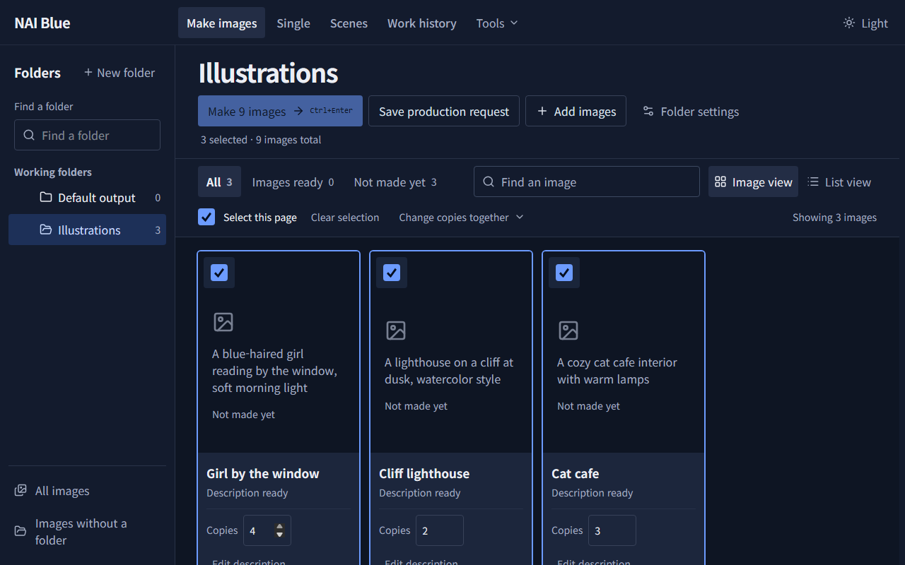
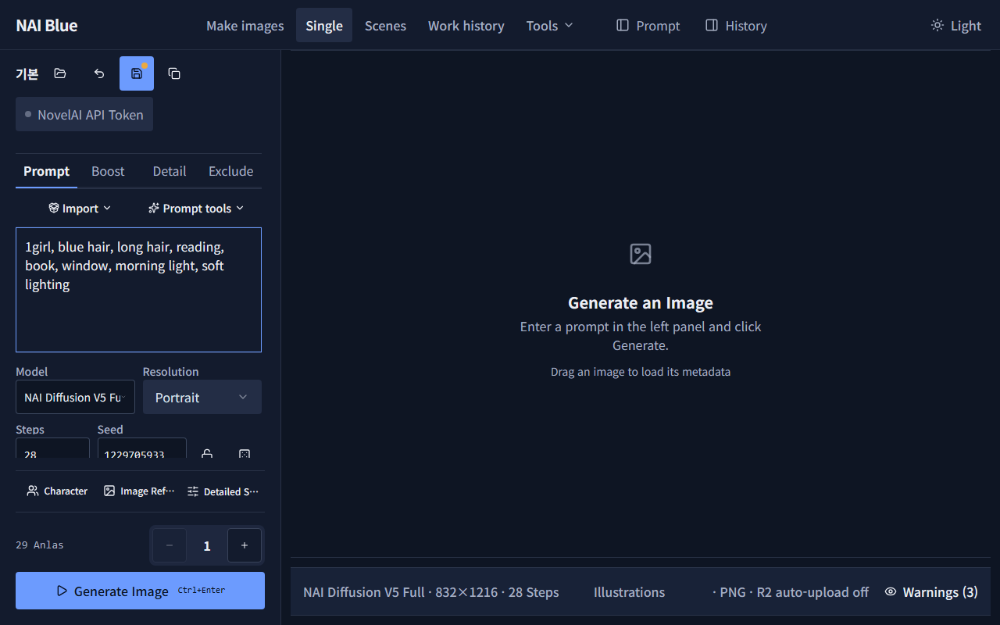
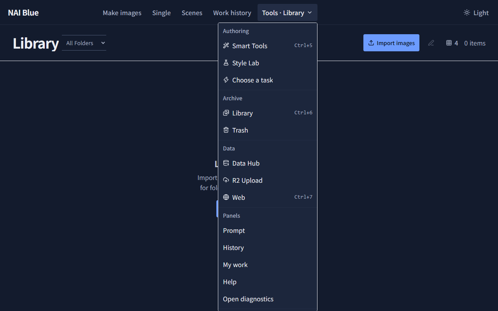

# NAI Blue

<p align="center">
  
</p>

<p align="center">
  A desktop and Android workspace for planning, generating, and organizing NovelAI images.
</p>

<p align="center">
  <a href="./README.md">English</a> ·
  <a href="./README.ko.md">한국어</a> ·
  <a href="./README.ja.md">日本語</a>
</p>

> NAI Blue is an independent community client and is not affiliated with or endorsed by NovelAI.



## What you can do

| Screen | What it is for |
|---|---|
| **Make images** | Collect image descriptions in folders, set how many copies each one gets, check the quantities and save location, then generate the whole batch. A batch can be saved as a production request and run again later. |
| **Single** | Write one prompt in four slots (Prompt, Boost, Detail, Exclude), add characters and image references, pick the model and resolution, and generate one image at a time. |
| **Scenes** | Keep prompts as cards and generate many scenes in one run. |
| **Work history** | Follow progress, review finished images, and handle jobs that need attention. |
| **Tools** | Smart Tools (background removal, mosaic, upscale, style analysis), Style Lab (artist-tag combinations tuned to your taste), Library, Trash, Data Hub, R2 Upload, a tag-search browser, and Settings. |

`Ctrl/Cmd+K` opens **Find command** from any screen, and `Ctrl/Cmd+Enter` runs the main action of the screen you are on.





## Install

Download the installer for your platform from [GitHub Releases](https://github.com/bluehair-blue/NAI-Blue/releases/latest).

- Windows: use the `x64-setup.exe` installer. The MSI is also provided for managed environments.
- macOS: use the build that matches Apple Silicon (`aarch64`) or Intel (`x64`). If Gatekeeper reports that the app is damaged, run `xattr -cr "/Applications/NAI Blue.app"` in Terminal after confirming that the file came from this repository.
- Android: install the signed universal APK. Android may ask you to allow installs from the app that opened the APK.

## First run

You need your own NovelAI account. **Tools → Help** opens the built-in getting-started guide and shows which of these steps still need attention.

1. Open the Credential Vault (from the guide or **Settings → API**), unlock it, then add your NovelAI token and verify it. The token is encrypted by the operating system's vault.
2. In the guide's **Output and privacy** step, choose where images are saved, the image format, and how metadata is handled: **Embed metadata**, **Sidecar only**, or **Strip image metadata and write sidecar**.
3. In **Make images**, write one description per image, set the copies, choose **Add images to make**, and start the batch with **Make N images**. For a one-off image, use **Single** and **Generate Image**.
4. Follow the jobs in **Work history**.

Cloudflare R2 upload is optional. Set it up in **Tools → R2 Upload** only if you want remote storage.

## Importing metadata

Drag an image onto **Single** to load its generation settings, or read up to 500 files at once in **Data Hub → Image info**. NAI Blue reads PNG, WebP, and JPEG images (including those made with NAIS2 and NAIS3), `.nai-blue.json` sidecars, and supported external sidecar JSON.

## Folders, devices, and privacy

- Each folder has its own save location, shared image description, and optional R2 upload.
- **Data Hub → Devices** connects the desktop and mobile apps so you can move data between them.
- Background removal and style analysis in **Smart Tools** send the selected image to external Hugging Face Spaces. NovelAI tokens are never sent there.
- On Android, desktop-only features remain visible along with the reason and an alternative.

## AI agents

NAI Blue can take requests from AI agents that you register in **Data Hub → AI editing**. A registered agent reads prompts, generation settings, and save locations, submits validated edits, and requests generation through the MCP adapter in this repository (`scripts/run-agent-mcp-stdio.mjs`). You decide for each registered client whether editing and generation need your approval every time.

Connection setup is in [ADR-013](docs/architecture/ADR-013-agent-folder-production.md), and the rules for automation agents are in [the agent automation guide](docs/에이전트%20자동화%20안내.md) (both in Korean).

## Troubleshooting and bug reports

Before reporting a problem:

1. Retry once with the same inputs and note the exact step that failed.
2. Choose **Tools → Open diagnostics**.
3. Use **Copy redacted log** or **Export JSON** for the related event.
4. Check the latest release notes and existing [issues](https://github.com/bluehair-blue/NAI-Blue/issues).

Submit a [bug report](https://github.com/bluehair-blue/NAI-Blue/issues/new?template=bug_report.yml) with:

- NAI Blue version, operating system, and installation type;
- the shortest reproducible sequence;
- expected and actual behavior;
- the displayed `DiagnosticCode` and redacted log;
- a screenshot with tokens, paths, prompts, and private metadata redacted.

Never attach a NovelAI token, Cloudflare secret, signing key, raw credential backup, or unreviewed private sidecar. For a security vulnerability, do not open a public issue; use the repository's private security advisory flow.

## Build from source

Requirements: Node.js 24 LTS, npm, Rust 1.93 or newer, and the native build tools required by Tauri. Python 3.11 is required when rebuilding the tagger sidecar.

```bash
git clone https://github.com/bluehair-blue/NAI-Blue.git
cd NAI-Blue
npm ci
npm run tauri dev
```

Useful checks:

```bash
npm run lint
npm run test:composition
npm run build
npm run tauri build
```

`npm run tauri build` produces the desktop app. Android builds and the release process are in [RELEASING.md](./RELEASING.md). The design contract is in [DESIGN.md](./DESIGN.md), and architecture decisions are indexed in [docs/README.md](./docs/README.md) (in Korean). `npm run docs:screenshots` regenerates the screenshots on this page.

## Credits and license

NAI Blue started from [NAIS2](https://github.com/sunanakgo/NAIS2); its wildcard and scene workflows also drew on [NAIA2.0](https://github.com/DNT-LAB/NAIA2.0) and [SDStudio](https://github.com/sunho/SDStudio).

Licensed under [GPL-3.0](./LICENSE).
